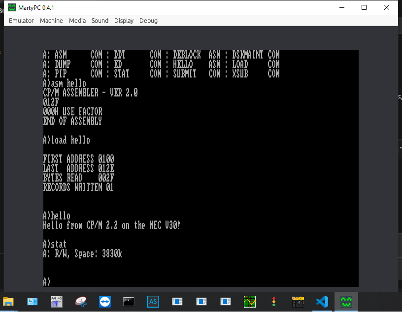

# pocket8086-cpm

**CP/M-80 2.2 that boots straight from the card on the Pocket8086, running in
the NEC V30's 8080 emulation mode.**



The NEC V20/V30 can run Intel 8080 code natively. `BRKEM` switches the CPU
into 8080 mode, and the instruction `CALLN` lets 8080 code call a native x86
routine that returns with `IRET`. This project uses those instructions to boot
a real CP/M 2.2 system: the CCP, BDOS, BIOS and every program run as genuine
8080 code. Each BIOS function is a `CALLN` into a small x86 handler that uses
the PC BIOS (INT 10h/13h/14h/16h/17h).

There is no DOS underneath and no software 8080 emulator: the machine boots
straight to `A>`.

Tested on a real Pocket8086 with a V30, and in [MartyPC](https://github.com/dbalsom/martypc)
(an XT with a V20 and XT-IDE).

## Requirements

* **An NEC V20 or V30 CPU** (on the Pocket8086, set the CPU jumper to V30).
  With an Intel 8086/8088 the loader says so and stops.
* A CF/SD card. Any size from 1 MB works. A small card gives one drive; larger
  cards get up to four 8 MB drives (A:-D:).
* **8080 software only.** The V30's 8080 mode has no Z80 instructions, so
  Z80-only programs (WordStar 4, Turbo Pascal, ...) will not run.
* To build: Python 3 and [NASM](https://www.nasm.us/) (on the PATH, in
  `tools/nasm-2.16.03/`, or set by the `NASM` environment variable).

It should work on any XT-class PC with a V20/V30 and a BIOS that boots a hard
disk through INT 13h (for example with the XT-IDE Universal BIOS).

## Build and write a card

```
python tools/build.py --sectors <card size in 512-byte sectors>
```

This assembles everything and writes `build/cpm.img`, with the files in
`cpmfiles/` placed on drive A:. To write the image on Windows, run this from
an elevated PowerShell:

```
tools\writecard.ps1 -DiskNumber <n> -ExpectedSize <card size in bytes>
```

`writecard.ps1` refuses to write to anything that isn't a removable USB/SD disk
of the expected size. It locks and dismounts the volume, writes the image and
reads it back to verify. On Linux/macOS, `dd` the image to the raw device.

**Windows will offer to "format" the card whenever it is inserted. Always click
Cancel.**

## Using it

* Console: the PC screen acts as an **ADM-3A / Kaypro II** terminal, so in a
  program's install menu, choose ADM-3A or Kaypro. Output goes straight into
  video memory, which keeps it fast.

  | Code | Action | Code | Action |
  |------|--------|------|--------|
  | `ESC = r c` | cursor to row r-32, column c-32 | `^Z`, `ESC *` | clear screen |
  | `^X`, `ESC T` | clear to end of line | `^W`, `ESC Y` | clear to end of screen |
  | `ESC E` | insert line | `ESC R` | delete line |
  | `ESC B0` / `ESC C0` | reverse video on / off | `ESC B1` / `ESC C1` | bright on / off |
  | `^K` `^L` `^H` | cursor up / right / left | `^^` | home |

  The arrow keys send `^E ^X ^S ^D` (WordStar style) and Del sends DEL.
* `LST:` = LPT1, `PUN:`/`RDR:` = COM1.
* Drive A: comes with the CP/M 2.2 utilities ASM, DDT, DUMP, ED, LOAD, PIP,
  STAT, SUBMIT (with DR's patch) and XSUB, plus DR's MAC, RMAC, LINK, LIB and
  XREF. They come from DR's distribution via
  [RomWBW](https://github.com/wwarthen/RomWBW). `MOVCPM` and `SYSGEN` are
  left out on purpose, because this system has no system tracks: SYSGEN would
  overwrite the directory. Also, **only run 8080 programs written for generic
  CP/M**. In 8080 mode, `IN`/`OUT` instructions reach the PC's real I/O ports,
  so machine-specific utilities (disk formatters and the like) can do damage.
* `HELLO.ASM` is a quick test:

```
A>ASM HELLO
A>LOAD HELLO
A>HELLO
Hello from CP/M 2.2 on the NEC V30!
```

### Other software (`extras/`)

`build.py` also copies a local `extras/` folder onto A:. Git ignores this
folder, so it's the place for software that can't be redistributed here.

**WordStar 3.30** runs well, including MailMerge and SpellStar. It is still
copyrighted, so this repository doesn't include it. Instead, one command
fetches it from the
[retroarchive.org WordStar collection](http://www.retroarchive.org/cpm/text/wordstar-collection.html),
checks its SHA-256, and sets it up:

```
python tools/get_wordstar.py                          # fills extras/
python tools/build.py --sectors N                     # new card, or:
python tools/cpmfiles.py D: put extras/* --force      # add to an existing card
```

It installs the Kaypro II build (`WSkayproii.COM`) as `WS.COM`, because it
uses the ADM-3A/Kaypro codes the console understands. On the Pocket8086, type
`WS`, then `D` and a file name to edit a document. Use `^KD` to save, and `X`
on the opening menu to return to CP/M.

Use only 8080 software: `tools/cpmsim.py` stops with an error if a program
executes a Z80-only instruction, so test new programs with it first.

## Copying files to and from the card

`tools/cpmfiles.py` reads and writes the CP/M file system directly, on the
card or on an image, without touching the files already there:

```
python tools/cpmfiles.py D: dir                   # list drive A: on the card in D:
python tools/cpmfiles.py D: put MBASIC.COM *.BAS  # copy files onto the card
python tools/cpmfiles.py D: get *.ASM -o backup   # copy files off the card
python tools/cpmfiles.py D: era OLD.COM           # delete files
python tools/cpmfiles.py build/cpm.img dir        # same commands on an image file
python tools/cpmfiles.py D: sys build/cpm.img     # update boot sector + loader only
```

`sys` installs a newly built loader (for example, a console update) without
touching any CP/M files. It refuses to write if the image was built for a
different card size.

* `-c B` selects CP/M drive B: (cards bigger than 8 MB have several drives),
  and `-u 3` selects user area 3. `--force` replaces existing files.
* Text files (`.ASM .TXT .SUB .HEX .DOC .MAC .LIB ...`) are converted to
  CP/M format (CR LF line ends, ^Z at the end) when they go in, and the ^Z is
  removed when they come out. Use `--binary` to turn this off, or `--text` to
  convert other files too (for example an ASCII `.BAS`). Binary files come
  back padded to a multiple of 128 bytes, because CP/M stores whole records.
* Card access needs administrator rights; the tool asks with a UAC prompt. It
  only works on a removable drive whose first sector holds this project's CP/M
  partition entry. It writes data before the directory, and reads back every
  sector it writes to verify it.

## How it works

| LBA   | Contents                                               |
|-------|--------------------------------------------------------|
| 0     | boot sector + partition table (one type 52h entry)     |
| 1-63  | native loader, CCP+BDOS image, 8080 BIOS               |
| 64-   | CP/M drives A:, B:, ... (up to 8 MB each)              |

1. **`src/boot.asm`**: the boot sector. It reads the loader with INT 13h
   (CHS, from the geometry INT 13h AH=08h reports).
2. **`src/loader.asm`**: the loader and the native back end:
   * detects a V20/V30 (NEC's `AAD` ignores its operand);
   * places the 8080's 64K at physical 10000h: CCP at E000h, BDOS at E800h,
     BIOS at F600h, about 56K TPA;
   * points interrupt vectors E0h-EFh at the `CALLN` handlers, and DFh at the
     8080 cold-boot entry;
   * sets CS=DS=ES=SS to the 8080 segment and executes `BRKEM DFh`.

   In 8080 mode the 8080's SP is the V30's BP, so the native SP stays free.
   The native stack (`BRKEM`, `CALLN` and hardware interrupts) lives at
   FE00h-FFFFh above the BIOS. Each `CALLN` handler switches to a private
   stack, does the work and `IRET`s back into 8080 mode. Disk I/O maps 128-byte
   CP/M records onto 512-byte card sectors through a one-sector cache, writing
   each change straight through to the card. Warm boot reloads the CCP and
   BDOS from a copy kept in memory.
3. **`src/bios.asm`**: the 8080 BIOS. It holds the jump table, `CALLN` stubs,
   `SELDSK`/`SECTRAN` in 8080 code, and the disk tables generated by `build.py`.
4. **`src/cpm22.asm`**: the CP/M 2.2 CCP and BDOS.

### Tools

* `tools/asm8080.py`: a two-pass 8080 assembler for Digital Research ASM
  syntax, plus a `CALLN` pseudo-op.
* `tools/build.py`: plans the drives to fit the card, generates the disk
  tables, assembles everything and writes the image with a CP/M directory.
* `tools/cpmfiles.py` / `tools/cpmfs.py`: copy files to and from a card or
  image (see above).
* `tools/cpmsim.py`: an 8080 simulator that runs the built system and handles
  each `CALLN` in Python. Use it for quick tests without hardware:
  `python tools/cpmsim.py --keys "DIR\rSTAT\r"`.
* `tools/martypc-config/pocket_test.toml`: a MartyPC machine definition (XT,
  V20, XT-IDE). To use it, copy it into MartyPC's `configs/machines/`, attach
  the image as the VHD for drive 0 (overwrite the start of a VHD with
  `build/cpm.img`), and set `config_name = "pocket_test"`.
* `tools/shot.ps1` and `tools/typekeys.ps1`: helpers for screenshotting and
  typing into MartyPC during automated tests.

## Credits and licenses

* Original code (boot sector, loader, BIOS, tools): MIT, see [LICENSE](LICENSE).
* CP/M 2.2 is by Digital Research. `src/cpm22.asm` is Clark A. Calkins'
  reconstruction of the CCP and BDOS, and the `.COM` utilities are DR's
  originals; both come from [The Unofficial CP/M Web Site](http://www.cpm.z80.de/).
  They are distributed under the DRDOS, Inc. grant in
  [CPM-LICENSE.txt](CPM-LICENSE.txt).
* NEC V20/V30 8080-mode details: NEC's V-series instruction manual and
  [MartyPC's notes on the V20](https://martypc.blogspot.com/2024/05/exploring-nec-v20-cpu.html).
